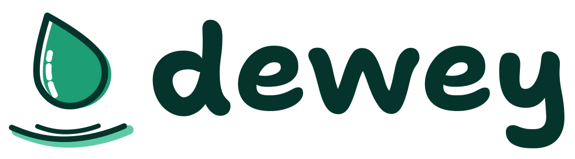
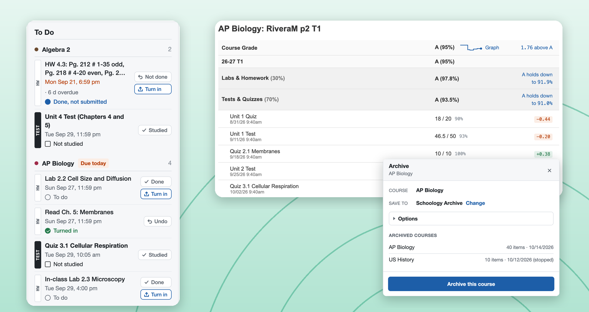
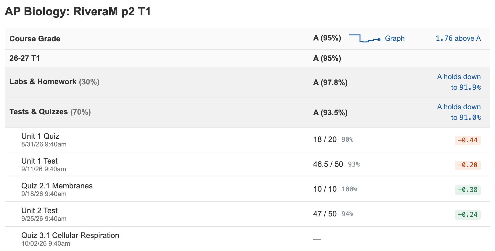
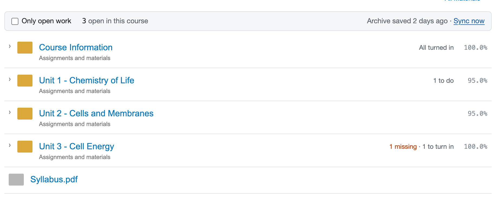
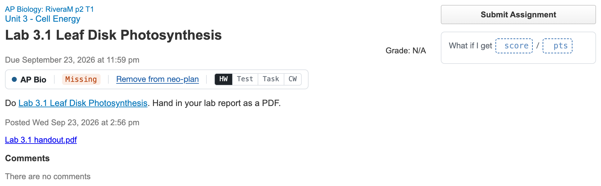
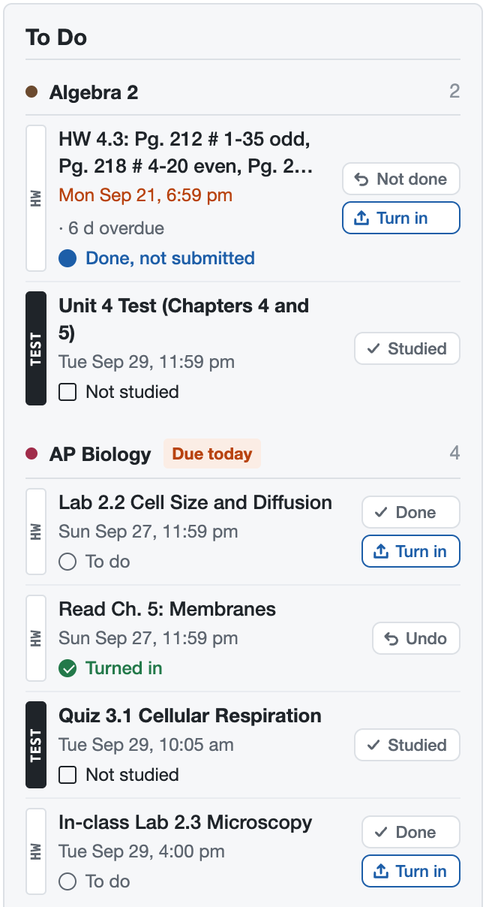
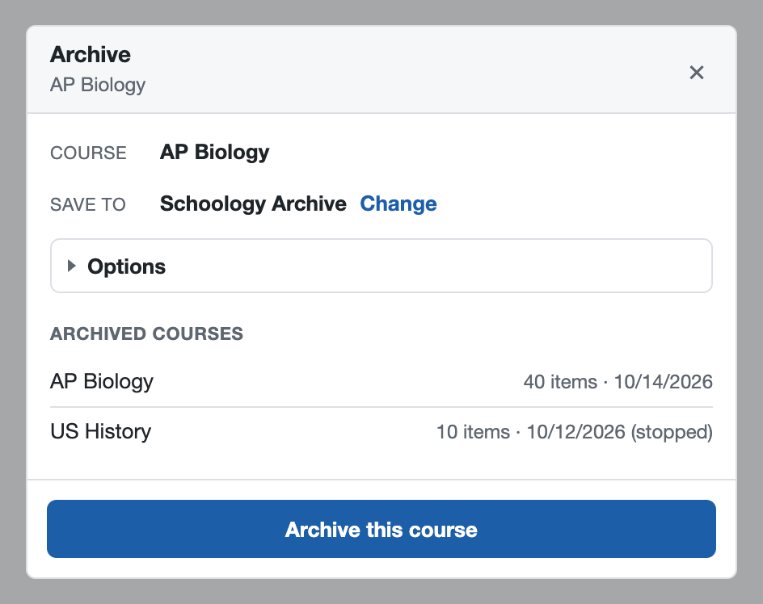
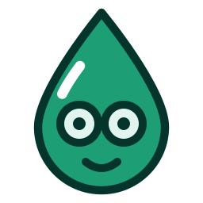
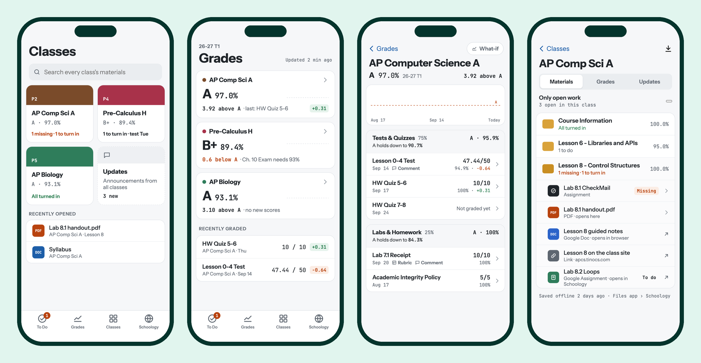

<div align="center">

<picture>
  <source media="(prefers-color-scheme: dark)" srcset="brand/logo/dewey-horizontal-dark.svg">
  
</picture>

### Schoology, but it finally makes sense.

**See what's due. Know your grade to the decimal. Save every class before it disappears.**<br>
A free Chrome extension for students on any school's Schoology, plus iPhone and Android apps in beta.

<br>

<a href="https://github.com/obfuscated-tm/dewey/releases/latest/download/dewey-extension.zip"></a>

<sub>Free · no account · no passwords · nothing leaves your computer</sub>

<br>

[](https://github.com/obfuscated-tm/dewey/releases/latest)    [](LICENSE)

[**Install**](#-install-the-extension-2-minutes) · [**Features**](#-what-you-get) · [**Phone apps**](#-dewey-for-iphone-and-android-beta) · [**Claude**](#-study-with-claude-optional) · [**Safety**](#%EF%B8%8F-is-it-safe) · [**Help**](#-troubleshooting)

<br>



</div>

---

## 🎯 What you get

<table>
<tr>
<td width="50%" valign="top">

### ✅ A To Do list that actually helps

Grouped by class, with the real due time, overdue work in **red** ("2 d late"), a **Due today** tag, and **Done** / **Turn in** buttons right on each row.

</td>
<td width="50%" valign="top">

### 📈 Your grade, to the decimal

A graph of your grade over the term, **how far above an A** you are, how low each category can drop, and how much each score moved you.

</td>
</tr>
<tr>
<td valign="top">

### 🔮 "What if I get a 38/50?"

Type a score you might get and watch your grade change. **Plan a test** tells you the score you need to keep your A.

</td>
<td valign="top">

### 📂 Find missing work fast

Every Materials folder shows what's still open ("1 missing · 1 to turn in") and your score. Tick **Only open work** to hide the rest.

</td>
</tr>
<tr>
<td valign="top">

### 💾 Save a whole class in one click

Schoology deletes classes when the term ends. Dewey saves slides, handouts, Google Docs (as PDFs), **your own submissions**, grades, and announcements to a folder you own.

</td>
<td valign="top">

### 🤖 Study with Claude

Optional add-on: ask Claude *"quiz me on Unit 3"* and it reads your actual slides and notes, then quizzes you one question at a time.

</td>
</tr>
</table>

<details open>
<summary><b>See it in action</b></summary>
<br>

**Grades page:** a graph of the term, how far above an A you are, how low each category can drop, and what each score did to your grade.



**Materials page:** every folder shows what's still open and your score.



**Assignment page:** a Missing chip and a what-if box right under the title.



<table>
<tr>
<th width="50%">To Do on the home page</th>
<th width="50%">Save a class</th>
</tr>
<tr>
<td valign="top" align="center"></td>
<td valign="top" align="center"></td>
</tr>
</table>

</details>

---

## ⚡ Install the extension (2 minutes)



**You need:** Google Chrome and a Schoology student login. No coding.

### 1. Download

<a href="https://github.com/obfuscated-tm/dewey/releases/latest/download/dewey-extension.zip"></a>

Double-click the ZIP to unzip it. You'll get a folder called **`dewey-extension`**. Move it somewhere it can stay, like **Documents**. (If you delete the folder, Chrome removes the extension.)

### 2. Add it to Chrome

1. Paste **`chrome://extensions`** into the address bar and press Enter.
2. Flip on **Developer mode** (top right).
3. Click **Load unpacked** and pick the **`dewey-extension`** folder.
4. Click the puzzle piece in the toolbar and pin **Dewey for Schoology**.

### 3. Open Schoology

That's it. Open Schoology and Dewey's **Welcome** card walks you through the rest, including where to save your classes.

> [!TIP]
> Chrome sometimes shows a *"Disable developer mode extensions"* bubble. That's normal for extensions installed from a folder. Just close it.

<details>
<summary><b>Updating to a new version</b></summary>
<br>

1. Download the [latest ZIP](https://github.com/obfuscated-tm/dewey/releases/latest/download/dewey-extension.zip) and unzip it.
2. Replace your old `dewey-extension` folder with the new one (same place, same name).
3. In `chrome://extensions`, click ↻ on Dewey, then refresh Schoology.

Your settings and saved classes stay. Click **Watch → Custom → Releases** at the top of this page to get an email when there's a new version.

</details>

<details>
<summary><b>Install from source instead (git)</b></summary>
<br>

```bash
git clone https://github.com/obfuscated-tm/dewey.git
```

Then **Load unpacked** the `extension` folder inside it. Run `git pull` and click ↻ to update. You need this way for the [Claude add-on](#-study-with-claude-optional).

</details>

---

## 💾 Save your classes


1. Open any class in Schoology.
2. Click **Archive** in the bottom-left corner → **Archive this course**.
3. Keep browsing. It runs in the background.

The first time, Dewey asks where to save. Make a folder like **Documents/Schoology Archive** and pick it. (Skip it and classes go to `Downloads/Schoology Archive`.)

> [!IMPORTANT]
> Re-archive every week or so, and **always once more before the term ends**. It only grabs what's new, so it's quick.

Each class becomes a normal folder you can open in Finder or File Explorer:

```text
Schoology Archive/
└── AP Biology/
    ├── INDEX.md                     start here: a list of everything
    ├── grades.md                    your gradebook
    ├── updates.md                   teacher announcements
    └── Unit 1 - Cells/
        ├── Lecture Slides.pdf       Google Slides, saved as a PDF
        ├── Guided Notes.pdf
        ├── Lab 1 (assignment).md    instructions, due date, grade, comments
        └── Lab 1 files/
            └── My submission.pdf    what you turned in
```

<details>
<summary><b>What gets saved, item by item</b></summary>
<br>

| In Schoology | You get |
|---|---|
| Files (PDFs, slides, images) | The original file |
| Google Docs, Slides, Drawings | A PDF |
| Google Sheets | An Excel file |
| Assignments | Instructions, due date, grade, comments, and **everything you submitted** |
| Quizzes | Questions and your answers, if your teacher lets you review them |
| Grades and announcements | `grades.md` and `updates.md` |
| Links, videos, Google Forms | Listed in `INDEX.md` |

**Nothing gets lost.** If a teacher updates a file, the new one is saved next to the old one. If they delete something, your copy stays.

</details>

---

## 📱 Dewey for iPhone and Android (beta)

<div align="center">

<br>
<sub>The iPhone app's To Do, Grades, Classes shelf and a class's page, with a made-up student. The Android app has the same screens.</sub>
</div>
<br>

Everything the extension does, rebuilt for your phone:

- **To Do** grouped by class, with a week strip (late work plus the next 7 days, tap a day to filter) and one-tap **Done** / **Turn in**. "Late" only means work Schoology still lists as overdue that you haven't finished, so paper work you've ticked off stops nagging.
- **Grades** with comments and rubrics, a grade-over-time graph you can drag, and **what-if** scores on every row, including made-up assignments. Hide a class you don't need (like study hall) with a long press.
- **Classes** as a shelf of books, each with a ribbon when work is late, due today or due tomorrow. Tap a book to see that class's open work first, then its **Materials**, which open right in the app (PDFs, Google Docs, class websites). Plus a search across every class.
- **Inbox** for announcements, school messages and updates from your school's groups (like a class hub), with new ones at the top.
- **Reminders**, home-screen widgets, and a countdown to your next test (a Live Activity on iPhone, a notification on Android).
- **A guided tour** on first launch: Dewey walks you through a pretend week (mark work done, submit, what-if, your shelf, Settings) without touching your real Schoology. Take it again from Settings → Help.
- **Light and dark mode**: the Dew look with a System / Light / Dark switch, and full Schoology one tab away when you need it.
- **Works with your school's course names**: Dewey guesses which courses are classes and which are groups (a hub, counseling, advisory). If it guesses wrong, switch any course in Settings → Classes.

Neither app is in a store yet. **On Android, [download the latest APK](https://github.com/obfuscated-tm/dewey/releases?q=android&expanded=true)** from Releases and open it on your phone. **On iPhone, you build it yourself** (below). Both only read Schoology; anything that changes it (like submitting) happens in Schoology's own page inside the app. Sign in with your school's normal Schoology login.

<details>
<summary><b>Build the iPhone app yourself</b></summary>
<br>

**You need:** a Mac, [Xcode](https://apps.apple.com/app/xcode/id497799835) (with the iOS 17+ SDK), [Node.js](https://nodejs.org), and [XcodeGen](https://github.com/yonaskolb/XcodeGen) (`brew install xcodegen`).

```bash
git clone https://github.com/obfuscated-tm/dewey.git
```

```bash
cd dewey/ios && npm install && xcodegen generate
```

```bash
open Dewey.xcodeproj
```

- **Simulator:** pick an iPhone simulator and press ▶. No Apple account needed.
- **Your own iPhone:** in [`ios/project.yml`](ios/project.yml), replace every `DEVELOPMENT_TEAM` with your own team ID and `com.owenleung` in the bundle IDs with something of yours, run `xcodegen generate` again, then plug in your phone and press ▶. A free Apple account works, but the app has to be re-installed every 7 days.

The design, screens and plan are in [`docs/ios/`](docs/ios/IOS-APP.md).

</details>

<details>
<summary><b>Build the Android app yourself</b></summary>
<br>

**You need:** [JDK 21](https://adoptium.net) and the [Android SDK](https://developer.android.com/studio) (Android Studio installs it). The phone needs Android 8.0 or newer.

```bash
git clone https://github.com/obfuscated-tm/dewey.git
```

```bash
cd dewey/android && ./gradlew assembleDebug
```

- **Your own phone:** turn on USB debugging, plug it in, and run `./gradlew installDebug` from `android/`. No Google account or Play Store needed.
- **Emulator:** open the `android` folder in Android Studio and press ▶, or install `app/build/outputs/apk/debug/app-debug.apk` with `adb install`.

If you change anything in `extension/engine/`, run `npm install` in `ios/` once so the build re-bundles it; otherwise it uses the bundle already in the repo. Android notes are in [`docs/android/`](docs/android/ANDROID-APP.md).

</details>

---

## 🤖 Study with Claude (optional)

Connect Dewey to [Claude Desktop](https://claude.ai/download) and just ask:

> **You:** I have a Unit 3 test in AP Bio on Friday. Quiz me on it, one question at a time.
>
> **Claude:** I found 6 files in your Unit 3 folder: the lecture slides, guided notes, and two practice sets. Let's start. Question 1: …

| Try asking… | What happens |
|---|---|
| "What do I have due this week?" | Lists your work, with overdue items first |
| "What's my grade in Chemistry, and what's pulling it down?" | Reads your gradebook |
| "Quiz me on Unit 3. Don't show answers until I try." | Reads your slides and notes, then quizzes you |
| "Search my saved classes for 'unit circle'." | Finds every file that mentions it |
| "Explain what HW 2.4 is asking. Don't do it for me." | Reads the instructions |
| "Any new announcements this week?" | Checks announcements in every class |

<details>
<summary><b>Set it up (about 5 minutes)</b></summary>
<br>

This needs the source download (see **Install from source** under [Install](#-install-the-extension-2-minutes)) (the ZIP only has the extension).

1. **Install Node.js** from [nodejs.org](https://nodejs.org) (pick LTS).
2. **Open Terminal** (Mac) or **Command Prompt** (Windows), go into the `dewey` folder, and run:

   ```bash
   cd mcp && npm install
   ```

3. **Tell Claude about it.** In Claude Desktop, open **Settings → Developer → Edit Config** and paste this in, with the paths changed to where *your* folders are:

   ```json
   {
     "mcpServers": {
       "schoology": {
         "command": "node",
         "args": ["/Users/you/Documents/dewey/mcp/server.js"],
         "env": { "SCHOOLOGY_ARCHIVE": "/Users/you/Documents/Schoology Archive" }
       }
     }
   }
   ```

4. **Quit and reopen Claude Desktop.**
5. **Check it works:** ask Claude *"What's my Schoology status?"*

Claude gets live answers while Chrome is open. When Chrome is closed, it uses your saved classes and tells you how old they are.

<sub>If Claude can't start it, replace `"node"` with Node's full path (on a Mac, run `which node`). More in [Troubleshooting](#-troubleshooting).</sub>

</details>

> [!NOTE]
> Claude works best as a study buddy: quizzing you, explaining, checking your understanding. Follow your school's rules on AI.

---

## 🛡️ Is it safe?

| Promise | What it means |
|---|---|
| **Looks, never touches** | It can't submit, post, or change anything on Schoology. |
| **Stays out of your tests** | It never opens or starts a quiz, and goes completely quiet while you have one open. |
| **Your stuff stays yours** | Nothing is uploaded anywhere. Saved classes are ordinary files in a folder you chose. |
| **No passwords** | It uses the Schoology login Chrome already has. |
| **Off switch** | Hide everything with the switch in Schoology's bottom-left corner, or press **Alt+Shift+K** to stop a save instantly. |
| **Nothing hidden** | Every line is right here to read. |

---

## ❓ Troubleshooting

| Problem | Try this |
|---|---|
| **Load unpacked** says "Manifest file is missing" | You picked the wrong folder. Pick the one with `manifest.json` directly inside it (`dewey-extension`, or `extension` in the source download). |
| I don't see Dewey on Schoology | In `chrome://extensions`, click ↻ on Dewey, then refresh Schoology. Make sure the switch in the bottom-left is on. |
| Everything disappeared while I'm taking a quiz | That's on purpose. It comes back after you close the quiz. |
| A save stopped halfway | Open the card and start it again. It picks up where it left off. If Schoology logged you out, log back in first. |
| Chrome keeps asking where to save files | In Chrome's settings, turn off **Ask where to save each file before downloading**. |
| A Google Doc was saved as a link, not a file | It isn't shared with you, or it's too big. The reason is in `INDEX.md`. |
| **Choose folder** button does nothing | Click Dewey's icon in Chrome's toolbar and choose it there, not from inside Schoology. |
| My letter grades look wrong | Your school probably uses a different grading scale. See [Change the grading scale](docs/DEVELOPING.md#change-the-grading-scale). |
| I see "Add to neo-plan" or "neo-plan needs an update" | You can ignore those. They're for an optional planner app (see [neo-plan](docs/DEVELOPING.md#neo-plan-optional-planner)). |
| Claude doesn't see Schoology | Quit and reopen Claude Desktop. Check the path in the config. Try replacing `"node"` with the full path from `which node`. |
| Claude says it's using saved (old) data | Open Chrome with Schoology, and make sure no quiz is open. |
| Claude can't find my saved classes | Set `SCHOOLOGY_ARCHIVE` in the config to your archive folder (see [Settings](docs/DEVELOPING.md#settings-environment-variables)). |

**Known limits:** quiz questions are only saved when your teacher lets you review them. Your change history lives in the extension, so if you remove it, the next save starts fresh (your files stay).


Still stuck? [Open an issue](https://github.com/obfuscated-tm/dewey/issues) and describe what happened. Dewey will be very sorry.

<br clear="left">

## 🔧 For developers

How it works, the MCP tools, settings, tests, project layout and releases are in [docs/DEVELOPING.md](docs/DEVELOPING.md).

---

## 📄 License

All rights reserved ([LICENSE](LICENSE)). The code is public to read, not to copy, change or share. No warranty.
