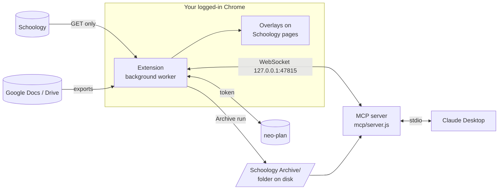

# Developing Dewey

For tinkerers and developers. You don't need any of this to use the extension. Back to the [README](../README.md).

## How it works



| Part | Folder | Version |
|---|---|---|
| Chrome extension (Manifest V3, plain ES modules, no build step) | [`extension/`](../extension/) | 1.12.0 |
| MCP server (Node, stdio) | [`mcp/`](../mcp/) | 1.1.0 |
| iPhone app (SwiftUI; runs the extension's parsers in a hidden web view) | [`ios/`](../ios/) | beta |
| Android app (Kotlin + Compose port of the iPhone app, same engine) | [`android/`](../android/) | beta (0.1) |

- The **extension** is the only part that talks to Schoology. It reads normal pages with your login, because many districts turn off Schoology's API for students.
- The **MCP server** answers from three sources, best first: **live** (asks the extension right now), **snapshot** (the extension's last background read, cached on disk), and **archive** (the folder). Every result includes `source` and `as_of`.

## MCP tools

All tools are read-only and return `{ source: "live" | "snapshot" | "archive", as_of, ... }`.

| Tool | Arguments | Sources | Returns |
|---|---|---|---|
| `status` | — | — | Extension connected?, bridge port, last snapshot, archive path, archived courses, course websites |
| `list_courses` | — | live → snapshot → archive | Courses, which have an archive, any course website |
| `get_todo` | — | live → snapshot → archive | What's due, soonest first |
| `get_grades` | `course` | live → archive | The gradebook |
| `get_assignment` | `course?`, `id?`, `title?` | live → archive | Instructions, due date, grade, attachments |
| `get_updates` | `course`, `page?` | live → archive | Announcements |
| `list_materials` | `course`, `folder_id?`, `path?`, `depth?` | live → archive | A course's folders and items |
| `find_material` | `query`, `course?` | live only | Find an item by name across every course's Materials |
| `open_material` | `course?`, `url?`, `id?`, `fetch_files?` | live only | One item's body, links, and up to 5 attached files |
| `fetch_page` | `url` | web | A course website, Google Doc, or Drive file/folder as text |
| `read_file` | `path` | archive only | One archived file: text, PDF text, or an image |
| `search` | `query`, `course?` | archive only | Matches in file names, text, and PDF contents |

A `course` argument takes a section ID (the number in `/course/<ID>/…`) or any part of the course name, case-insensitive. An ambiguous name returns the candidates. Full reference: [`mcp/README.md`](../mcp/README.md).

## Settings (environment variables)

All optional. Put them in an `env` block in Claude Desktop's config.

| Variable | Default | Meaning |
|---|---|---|
| `SCHOOLOGY_ARCHIVE` | `../Schoology Archive` (next to `mcp/`) | Where your saved courses are |
| `SCHOOLOGY_EXT_ID` | unset | Only accept the bridge connection from this extension ID (from `chrome://extensions`) |
| `SCHOOLOGY_MCP_HOME` | `~/.schoology-mcp` | Snapshot cache, PDF text cache, downloaded-file cache |

```json
{
  "mcpServers": {
    "schoology": {
      "command": "/opt/homebrew/bin/node",
      "args": ["/Users/you/Documents/dewey/mcp/server.js"],
      "env": { "SCHOOLOGY_ARCHIVE": "/Users/you/Downloads/Schoology Archive" }
    }
  }
}
```

The config file lives at `~/Library/Application Support/Claude/claude_desktop_config.json` (macOS) or `%APPDATA%\Claude\claude_desktop_config.json` (Windows). To run the server by hand and see its log:

```bash
node mcp/server.js
```

The bridge uses the first free port in 47815–47819. If none are free, the server runs without **live**.

## Course websites (`sites.json`)

Some classes keep lessons on a public website outside Schoology. List them in [`mcp/sites.json`](../mcp/sites.json) so Claude can find and read them:

```json
[
  { "course": "AP Comp Sci", "url": "https://apcs.tinocs.com/", "note": "Lessons are .md pages" }
]
```

`course` matches part of the course name. `note` is optional. **The file in the repo lists the author's classes**, so replace them with yours or use `[]`. Restart Claude Desktop after editing.

`fetch_page` sends no cookies to public sites, times out after 15 s, caps downloads at 15 MB, follows at most 5 redirects, and refuses local or private network addresses.

## Change the grading scale

The Grades page assumes A = 93%, A− = 90%, B+ = 87%, B = 83%, and so on down to D = 60%. If your school's scale is different, edit `SCALE` and `A_CUTOFF` at the top of [`extension/overlays/grademath.js`](../extension/overlays/grademath.js), then click ↻ on the extension in `chrome://extensions`.

If a category shows no weight, type it next to the category name on the Grades page. It's saved per course.

## neo-plan (optional planner)

[neo-plan](https://neo-plan.vercel.app) is a separate planner app built alongside this extension. Skip this unless you have an account.

1. In neo-plan, go to **Settings** and make an extension token (starts with `np_`).
2. On any Schoology page, open Settings (the gear, bottom left) → **neo-plan**, paste it and click **Connect**.

The extension then reads Schoology (GET only) every 15 minutes, when a Schoology page loads (at most every 5 minutes), and on **Check now**. neo-plan files work into columns, clears what you've submitted, and flags what's Missing. This background read is also the MCP server's **snapshot** source.

Without a token, the neo-plan parts of the overlays (type tags, **+ Add to neo-plan**, clickable **Studied** / **Done**) stay hidden, and everything else works. The token stays in the background worker, and Schoology pages never see it.

## Quiz safety, in detail

- `reader/client.js` refuses quiz-taking URLs (`/assignment/…/assessment`, `/assessments/{id}/take|start|resume`) and the dropbox submit form.
- To save answer reviews, the archiver opens the quiz page in a background tab and clicks only links whose whole text is exactly **View** in the Previous Attempts table.
- **Quiet mode** (`sync/quiet.js`): while any tab has `assessment` in its path, there's no sync, no MCP bridge, and no archive. Opening one stops everything, like Alt+Shift+K does.
- Content scripts are excluded from every `*assessment*` and `/assignment/*/dropbox*` page in `manifest.json`.

## Project layout

```text
.
├── extension/               the Chrome extension (Dewey for Schoology)
│   ├── manifest.json        version lives here
│   ├── background.js        run lock, kill switch, sync schedule, message routing
│   ├── engine/              the phone apps' engine: the extension's own parsers, bundled
│   ├── reader/              everything that reads Schoology (client.js + parse/)
│   ├── outputs/archive/     the archive run, saving, change tracking, Google exports
│   ├── outputs/neoplan/     every call to neo-plan
│   ├── outputs/mcp/         the WebSocket bridge to the MCP server
│   ├── sync/                background sync, scheduling, quiz quiet mode
│   ├── offscreen/           DOM parsing and the archive job
│   ├── overlays/            what's drawn on Schoology pages
│   ├── panel/               neo-plan frame and folder picker for the Settings card
│   └── test/                tests + stand-in pages
├── ios/                     the iPhone app (SwiftUI; XcodeGen spec in project.yml)
├── android/                 the Android app (Kotlin + Compose; Gradle wrapper)
├── mcp/                     the Claude add-on (local MCP server)
│   ├── server.js
│   ├── sites.json           course websites
│   ├── src/                 tools, bridge, cache, archive reader, PDF text, network guard
│   └── test/
├── brand/                   logo, mascot, icons, colours (placeholder art for now)
├── docs/
│   ├── extension/           overlay design and grade math
│   ├── ios/                 the iOS plan, engine contract, findings, screens, mockups
│   ├── android/             Android-specific notes (the iOS docs stay the source of truth)
│   ├── mcp/                 the extension-to-MCP bridge contract
│   ├── history/             finished plans
│   └── images/              README screenshots (make/ has the scripts that take them)
└── package.json             `npm test` runs the extension and MCP tests
```

The extension's own [README](../extension/README.md) has a file-by-file map.

## Tests and previews

```bash
npm test
```

That runs both suites (`npm run test:extension`, `npm run test:mcp`). At extension 1.12.0 / MCP 1.1.0 there are 215 + 59 tests, all passing. The phone apps have their own tests: Xcode's test action for `ios/`, and `./gradlew testDebugUnitTest` for `android/`.

The `test/*.html` pages are stand-ins for Schoology pages, so you can look at the overlays without logging in:

```bash
python3 -m http.server 8765 --directory extension
```

Then open <http://localhost:8765/test/grades-page.html> (or `materials-page`, `home-page`, `assignment-page`, `archive-card`). They show a made-up student's classes.

The README screenshots come from these pages and from the iPhone app's demo mode (a Debug build launched with `-DeweyDemo`, see [`ios/App/Engine/Demo.swift`](../ios/App/Engine/Demo.swift)). With the server above running, `node docs/images/make/shoot.mjs` retakes the extension shots and `python3 docs/images/make/hero.py` rebuilds the hero; [`docs/images/make/phones.py`](images/make/phones.py) frames the simulator screenshots.

**Rules the code follows:** GET only; never touch a quiz; overlays only add, in their own shadow DOM; the neo-plan token stays in the background worker; the MCP server is read-only and binds to `127.0.0.1`.

## Versioning and releases

The extension and the MCP server each have their own [semantic version](https://semver.org):

- **Major:** breaking change (archive layout, bridge contract, a removed tool)
- **Minor:** new feature
- **Patch:** bug fix

| Component | Version lives in | Tag |
|---|---|---|
| Extension | `extension/manifest.json` | `ext-v1.13.0` |
| MCP server | `mcp/package.json` | `mcp-v1.1.1` |

If a change touches the bridge contract ([`docs/mcp/MCP-BRIDGE.md`](mcp/MCP-BRIDGE.md)), bump both.

**To release:** bump the version, add a [`CHANGELOG.md`](../CHANGELOG.md) entry, run both test suites, commit, then tag and push:

```bash
git tag -a ext-v1.14.0 -m "Extension 1.14.0"
```

```bash
git push origin main --tags
```

Pushing an `ext-v*` tag runs [`.github/workflows/release-extension.yml`](../.github/workflows/release-extension.yml), which packs `extension/` (minus `test/`) into `dewey-extension.zip` and attaches it to a GitHub release. The README's Download button always points at the latest one. To re-pack the current version without a new tag, run the workflow by hand from the **Actions** tab.

## More documentation

| File | What's in it |
|---|---|
| [`extension/README.md`](../extension/README.md) | Full extension reference and code map |
| [`mcp/README.md`](../mcp/README.md) | Full MCP server reference |
| [`docs/mcp/MCP-BRIDGE.md`](mcp/MCP-BRIDGE.md) | The extension↔MCP WebSocket contract |
| [`docs/extension/OVERLAY-UI.md`](extension/OVERLAY-UI.md) | Overlay design and grade math |
| [`docs/ios/IOS-APP.md`](ios/IOS-APP.md) | The iPhone app: rules, layout, milestones |
| [`docs/android/ANDROID-APP.md`](android/ANDROID-APP.md) | The Android app: build, layout, how iOS maps to Android |
| [`docs/history/EXTENSION-STEPS.md`](history/EXTENSION-STEPS.md) | The original build plan (history) |
| [`CHANGELOG.md`](../CHANGELOG.md) | What changed in each version |
